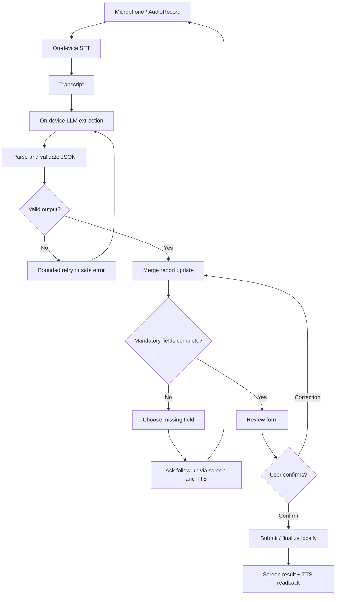

# Architecture

## Design goals

- Offline-first and fully on-device.
- Reliable structured extraction with explicit validation.
- No hallucinated field values.
- Incremental updates: corrections and later additions modify the current report.
- Keep Android UI, orchestration, and model-runtime integration separable.
- Use vendor-provided samples and documented APIs rather than guessed Qualcomm APIs.

## High-level flow

## Components

### 1. Audio capture
- Android `AudioRecord` is the provisional implementation.
- Target audio format proposed in the handoff: 16 kHz, mono.
- Confirm the board microphone path and supported sample format before locking this down.
- Keep audio capture independent from model invocation so recorded test clips can be used during development.

### 2. Speech-to-text adapter
- Calls the confirmed on-device STT model/runtime.
- Returns transcript plus error/status metadata.
- Do not assume a specific Qualcomm runtime until verified.
- Keep an adapter interface so the actual SDK integration can be isolated.

### 3. Extraction adapter
- Receives transcript, current report state, and schema.
- Uses the on-device LLM to return a structured patch, not an unconstrained replacement report.
- Prompt for evidence-grounded extraction and explicit `null` for unknown fields.
- Validate JSON and field types in ordinary application code.

### 4. Report state manager
- Owns current report state and field provenance.
- Merges new extracted values into existing state.
- Supports corrections such as “actually make that 11 AM” and additions such as “Ravi also saw it.”
- Keeps user-confirmed values stable unless explicitly corrected.

### 5. Mandatory-field controller
- Maintains the required-field list, which must be agreed with organizers/team.
- Selects one clear missing field at a time.
- Generates a deterministic follow-up question from the missing field.
- Does not delegate completeness decisions entirely to the LLM.

### 6. Review UI
- Kotlin + Jetpack Compose is the proposed stack.
- Shows extracted values, unknown fields, and stated/inferred provenance.
- Lets the user correct values before finalization.
- UI framework remains a proposal until the team confirms the project setup.

### 7. Text-to-speech
- Android offline `TextToSpeech` is the proposed first option; verify that it works with network disabled.
- Piper is an alternative only if it can be packaged and run locally within project constraints.
- Never rely on a network-backed voice service.

### 8. Local evaluation harness
- Python scripts on the laptop evaluate fixed audio/transcript cases.
- The harness is a development tool, not a runtime dependency of the shipped app.
- Report WER and field-level metrics.

## Trust boundaries

- The model is an untrusted parser, not the authority for required fields or submission state.
- Model output must pass JSON parsing, schema validation, and type checks.
- Unknown fields remain `null`.
- No network calls or cloud SDKs in the shipped path.
- Airplane-mode testing is required evidence of offline operation.

## Proposed package boundaries

These are suggestions, not existing files:

- `audio/`: capture and audio configuration
- `stt/`: STT adapter and transcript result
- `inference/`: LLM runtime adapter and extraction prompt
- `domain/`: report model, provenance, merge rules, validation
- `workflow/`: state machine and follow-up policy
- `ui/`: Compose screens and review/correction interactions
- `tts/`: offline speech output
- `evaluation/`: laptop-side dataset and scripts (may live outside Android app)
