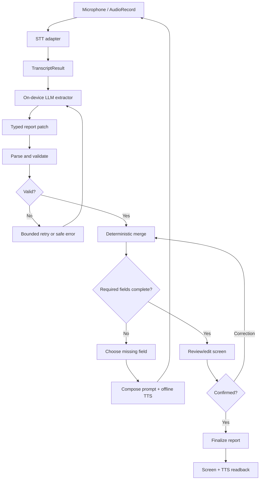

# Architecture

## Runtime flow

## Logical modules
- `:app` — Android entry point, lifecycle, permissions and dependency wiring.
- `:core:domain` — report types, evidence/provenance and validation.
- `:core:contracts` — `SttEngine`, `IncidentExtractor`, `SpeechOutput` interfaces.
- `:core:workflow` — state machine, merge, required-field checks and follow-up policy.
- `:feature:audio` — microphone capture and permissions.
- `:feature:report` — Compose report/review/correction UI.
- `:adapter:stt` — verified supplied-model STT adapter.
- `:adapter:llm` — verified supplied-model LLM adapter.
- `:adapter:tts` — offline TTS adapter.
- `evaluation/` — Python laptop-side harness, not shipped in Android app.

Keep these as logical boundaries initially; create separate Gradle modules only where it helps parallel work. Domain/contracts should have no vendor-runtime dependency.

## Parallel development
- Laptop A: STT + audio adapter.
- Laptop B: LLM extraction + TTS (same laptop/workstream, per request).
- Laptop C or integration owner: schema, workflow, Compose UI and app wiring, using fake adapters first.
- Evaluation can run on any laptop with Python.
- Integrate real adapters one at a time on the Qualcomm board. Laptop simulation does not prove NPU acceleration.
