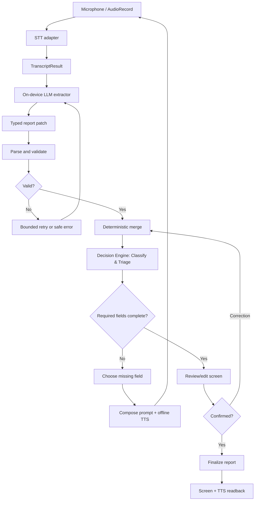

# Architecture

## Runtime flow

## Logical modules
- `:app` — Android entry point, lifecycle, permissions and dependency wiring.
- `:core:domain` — report types, evidence/provenance and validation.
- `:core:contracts` — `SttEngine`, `IncidentExtractor`, `SpeechOutput`, `DecisionEngine` interfaces.
- `:core:workflow` — state machine, merge, required-field checks, classification rules and follow-up policy.
- `:feature:audio` — microphone capture and permissions.
- `:feature:report` — Compose report/review/correction UI.
- `:adapter:stt` — verified Qualcomm AI Hub STT (Whisper) adapter.
- `:adapter:llm` — verified Qualcomm AI Hub LLM (Llama-3.2 via GenieX) adapter.
- `:adapter:tts` — offline TTS adapter.
- `:adapter:decision` — Decision engine adapter (`LocalRuleDecisionEngine` on-device; optional `JevCloudDecisionEngine` for cloud/hybrid experiments).
- `evaluation/` — Python laptop-side harness (WER, field accuracy, and Jev shadow benchmark).

Keep these as logical boundaries initially; create separate Gradle modules only where it helps parallel work. Domain/contracts should have no vendor-runtime or cloud dependency.

## Role separation: LLM vs Jev vs Deterministic workflow
1. **Generative LLM (On-device Llama-3.2 on NPU):** Converts unstructured audio transcripts into structured report field patches (extracts entities, descriptions, actions, dates).
2. **Deterministic Kotlin Workflow (On-device):** Strict business logic. Checks whether mandatory fields are non-null, coordinates state transitions, performs presence-aware patch merging, and selects follow-up questions.
3. **Decision Engine (Incident classification & severity triage):**
   - **Production path (On-device):** Deterministic heuristics or prompt-constrained on-device LLM categorization.
   - **Evaluation / Shadow path (Laptop-side Jev):** TypeSafe AI's Jev model evaluates typed `Choice` (category), `Score` (severity 1–5), and `Noul` (urgency probability) questions via cloud API to benchmark decision quality against human ground truth.
4. **Offline Rule:** Jev is hosted on the cloud and **must never** be a hard dependency for the on-device APK.

## Parallel development
- Laptop A: STT + audio adapter (Whisper).
- Laptop B: LLM extraction (Llama-3.2) + TTS in one environment.
- Laptop C or integration owner: schema, workflow, Compose UI and app wiring, using fake adapters first.
- Evaluation: Python laptop harness, evaluating WER, extraction accuracy, and Jev decision benchmarks.
- Board integration: Integrate real adapters one at a time on the Qualcomm QIDK board. Laptop simulation does not prove NPU acceleration.
